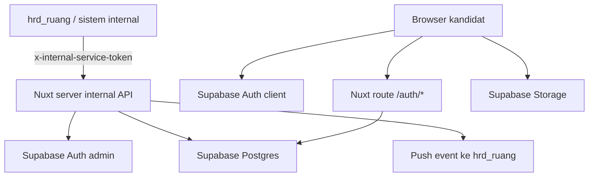

# 01 Project Overview

> Last verified against current repository state: 2026-06-23

## Gambaran Umum Aplikasi

`hrd_pintu` adalah portal kandidat terpisah dari `hrd_ruang`. Aplikasi ini dipakai kandidat atau employee yang telah diprovisikan oleh sistem internal untuk:

- login dengan email dan password
- melihat daftar aplikasi yang dimiliki
- mengisi atau melanjutkan form lamaran
- mengunggah foto dan dokumen pendukung
- mengganti password akun

## Tujuan Aplikasi

- Menjadi portal self-service kandidat/employee.
- Menjadi source of truth form kandidat berbasis Supabase.
- Menyediakan internal API agar sistem lain dapat membuat dan mengelola akun kandidat.
- Mengirim ringkasan event kandidat kembali ke `hrd_ruang`.

## Masalah Yang Diselesaikan

- Memisahkan portal kandidat dari dashboard internal.
- Menyimpan data kandidat per aplikasi (`candidate_applications`) dengan form detail (`candidate_form`).
- Memungkinkan kandidat mengunggah dokumen langsung ke Supabase Storage dengan pembatasan path dan kepemilikan.
- Memungkinkan sistem internal mengelola lifecycle akun kandidat tanpa membuka akses service role ke browser.

## Pengguna Aplikasi

| Pengguna | Cara akses | Catatan |
| --- | --- | --- |
| Kandidat | UI web + Supabase Auth | role `candidate` |
| Employee | UI web + Supabase Auth | role `employee`; form yang tampil berbeda |
| Sistem internal `hrd_ruang` | Internal API + shared token | bukan user UI, tetapi integrator utama |

## Role Pengguna

| Role | Ditemukan di code | Kemampuan utama |
| --- | --- | --- |
| `candidate` | Ya | login, lihat dashboard, isi form kandidat, upload foto, upload dokumen kandidat |
| `employee` | Ya | login, lihat dashboard employee, isi payroll form, upload dokumen employee, generate preview dokumen tertentu |

Catatan:

- role portal `admin` tidak ditemukan di repo ini
- pengelolaan kandidat dilakukan lewat internal API dan sistem eksternal seperti `hrd_ruang`

## Ringkasan Fitur Utama

- Autentikasi Supabase Auth
- Route guard dengan middleware global
- Dashboard daftar aplikasi
- Form kandidat multi-seksi
- Form payroll employee
- Upload foto ke bucket `candidate-photographs`
- Upload dokumen ke bucket `candidate-documents`
- Generate preview dokumen employee untuk:
  - `integrity_pact`
  - `email_usage_policy`
- Internal candidate service:
  - list kandidat
  - create kandidat
  - update kandidat
  - tambah aplikasi
  - reset password
  - aktif/nonaktif akun
  - revoke akun
  - ambil summary kandidat
  - baca snapshot form
  - append dokumen kontrak employee
  - buat signed URL storage

## Ringkasan Flow Bisnis

1. Sistem internal membuat akun kandidat melalui internal API.
2. Backend membuat atau memakai user Supabase Auth yang sudah ada.
3. Backend membuat record `candidate_accounts` dan `candidate_applications`.
4. Saat kandidat membuka form lamaran, backend memastikan `candidate_form` tersedia. Jika kandidat pernah punya form di lamaran lain, data terakhir disalin sebagai draft awal.
5. Kandidat menyimpan draft, mengunggah file, lalu submit form.
6. Backend mengubah status aplikasi menjadi `submitted` dan mengirim event sinkronisasi.
7. Jika portal role diubah menjadi `employee`, halaman form berubah menjadi wizard 2 langkah untuk payroll dan dokumen employee.

## Ringkasan Flow Teknis

## Catatan Scope

Bagian berikut diminta dalam daftar kebutuhan dokumentasi, tetapi belum ditemukan sebagai fitur aktif di repo ini:

- Import CSV
- Upload template DOCX dari UI
- Deteksi placeholder DOCX
- Export Configuration
- Mapping field export
- Download file hasil generate DOCX
- Audit log table khusus

Status untuk item-item di atas ditulis sebagai `Belum ditemukan di implementasi saat ini` atau `Perlu dikonfirmasi` pada dokumen terkait.
