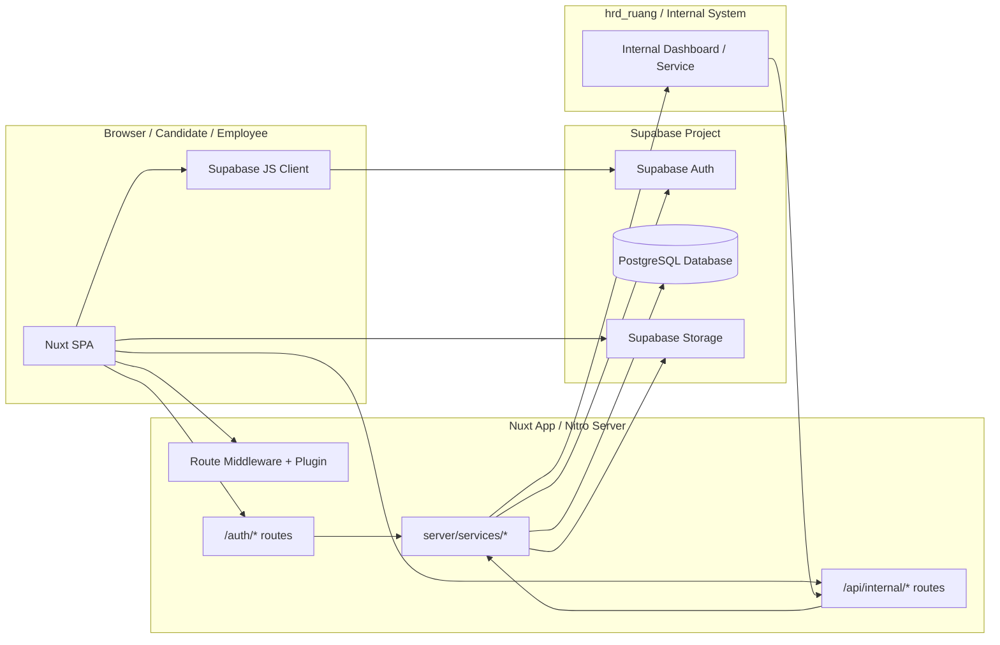
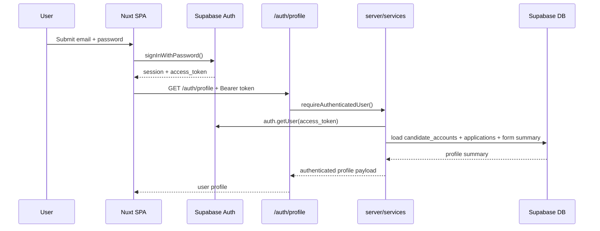
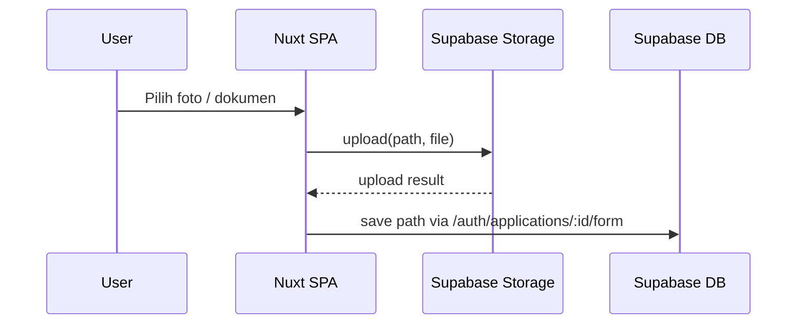

# 03 System Architecture

> Last verified against current repository state: 2026-06-23

## Arsitektur Sistem Aktual

Arsitektur repo ini terdiri dari 3 lapisan utama:

1. SPA Nuxt di browser
2. Nuxt server/Nitro route untuk auth dan internal API
3. Supabase sebagai auth, database, dan storage

Tambahan integrasi:

- `hrd_ruang` atau sistem internal lain memanggil internal API untuk lifecycle kandidat.
- `hrd_pintu` mengirim event kembali ke `hrd_ruang` melalui `HRD_PINTU_SYNC_BASE_URL`.

## Diagram Arsitektur

## Alur Komunikasi Nuxt.js Dengan Supabase

### Client-side Flow

1. Browser membuat Supabase client melalui `src/infrastructure/supabase/client.ts`.
2. Nilai `supabaseUrl` dan `supabaseAnonKey` dibaca dari runtime config public.
3. Browser memakai Supabase client untuk:
   - `signInWithPassword`
   - `signOut`
   - `getUser`
   - `getSession`
   - upload file ke storage
   - create signed URL foto kandidat

### Server-side Flow

1. Route `/auth/*` dan internal API memanggil helper/service di `server/services`.
2. Service backend membuat admin client melalui `server/services/supabaseAdmin.js`.
3. Admin client memakai `SUPABASE_SERVICE_ROLE_KEY` untuk:
   - validasi access token via `supabase.auth.getUser`
   - CRUD tabel kandidat
   - create/update auth user
   - create signed URL internal

## Authentication Flow

## Database Query Flow

### Login / Init Auth

1. Client memanggil `supabase.auth.getUser()`.
2. Jika ada session, client memanggil `/auth/profile`.
3. Backend memverifikasi token ke Supabase Auth.
4. Backend membaca `candidate_accounts`, `candidate_applications`, dan snapshot `candidate_form`.

### Form Load

1. Client memanggil `GET /auth/applications/:applicationId/form`.
2. Backend memverifikasi pemilik aplikasi.
3. Backend memastikan `candidate_form` ada.
4. Jika belum ada, backend membuat form baru dan menyalin snapshot form terakhir kandidat bila tersedia.
5. Backend mengembalikan `draft_data` yang sudah dinormalisasi.

### Form Save

1. Client unggah file ke storage lebih dulu bila ada file baru.
2. Client memanggil `PATCH /auth/applications/:applicationId/form`.
3. Backend menormalkan payload, update tabel induk `candidate_form`, lalu sinkron tabel child.
4. Backend mengirim event `candidate.form_progress_updated`.

### Form Submit

1. Client memanggil `POST /auth/applications/:applicationId/submit`.
2. Backend menandai `candidate_form.completion_status = completed`.
3. Backend menandai `candidate_applications.status = submitted`.
4. Backend mengirim event `candidate.application_submitted` atau `candidate.employee_draft_contract_submitted`.

Catatan implementasi:

- Fungsi submit backend memang memanggil `validateFormSubmission`, tetapi helper itu masih stub dan hanya mengembalikan `draftData` tanpa enforcement field wajib di server.
- Di sisi frontend, `canSubmitForm` pada `useCandidateApplicationFormPage.ts` sudah memvalidasi field wajib (data pribadi, kontak, kontak darurat, pendidikan formal, riwayat kerja pertama, minimum 2 referensi lengkap, mobilitas/domisili, gaji yang diharapkan, dokumen wajib) sebelum tombol submit aktif, sehingga risiko utama kini hanya ada bila request submit dikirim langsung tanpa lewat UI (bypass validasi client).
- Tidak ditemukan status database terpisah untuk employee draft contract; event `candidate.employee_draft_contract_submitted` tetap berjalan dengan `completion_status = completed`.

## Storage Upload/Download Flow

### Foto Kandidat

- Bucket: `candidate-photographs`
- Path: `candidate-forms/<auth.uid()>/pas-photo-<slug>-<yyyymmdd>.<ext>`
- Preview: signed URL dibuat langsung dari browser dengan `supabase.storage.createSignedUrl()`

### Dokumen Kandidat/Employee

- Bucket: `candidate-documents`
- Path: `employee-forms/<auth.uid()>/<documentType>/<filename>`
- Path yang dihapus dari UI hanya dihapus dari field draft, bukan file fisik di storage

### Signed URL Internal

Endpoint `POST /api/internal/storage/sign-url` tersedia untuk membuat signed URL setelah memverifikasi:

- bucket valid
- prefix path valid
- `candidate_form_id` valid
- path benar-benar dimiliki oleh candidate form

Tidak ditemukan pemanggilan endpoint ini dari frontend repo ini.

## Document Generation Flow

### Yang Ditemukan

1. Tipe dokumen `integrity_pact` dan `email_usage_policy` digenerate di browser.
2. Generator membangun HTML cetak dari data form + profil user.
3. Hasilnya dibuka di jendela baru via `window.open`.

## Security Consideration

- `SUPABASE_SERVICE_ROLE_KEY` dipakai hanya di server.
- Route sensitif mendapat:
  - CSP
  - `X-Frame-Options: DENY`
  - `X-Content-Type-Options: nosniff`
  - `Cache-Control: no-store`
- Internal API diamankan dengan `x-internal-service-token`.
- Tabel business memakai RLS `SELECT` only untuk user authenticated.
- Storage object policy memakai helper SQL `can_access_candidate_storage_object` dan `can_write_candidate_storage_object`.
- Candidate role otomatis kadaluarsa setelah 3 hari jika masih aktif.
