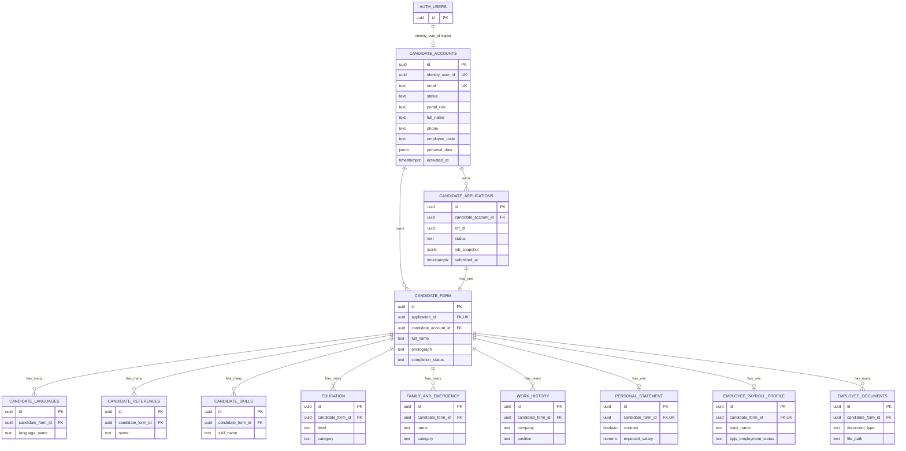

# 06 ERD

> Last verified against current repository state: 2026-07-06

## Sumber Referensi

ERD ini disusun dari:

- `sql/migration/public-schema.sql`
- migration incremental di `sql/migration/*.sql`
- query dan kontrak data di service backend

Catatan:

- `public-schema.sql` dipakai sebagai acuan struktur tabel/fungsi/constraint pada schema `public` yang tersedia di repository.
- Interpretasi relasi tetap divalidasi terhadap migration aktif dan service code, terutama untuk relasi logis ke `auth.users`.

## ERD Mermaid

## Kardinalitas

| Relasi | Kardinalitas | Catatan |
| --- | --- | --- |
| `auth.users` -> `candidate_accounts` | 1 ke 0..1 | relasi logis melalui `identity_user_id` |
| `candidate_accounts` -> `candidate_applications` | 1 ke banyak | satu akun bisa punya beberapa aplikasi |
| `candidate_applications` -> `candidate_form` | 1 ke 1 | `application_id` unik |
| `candidate_accounts` -> `candidate_form` | 1 ke banyak | satu akun bisa punya form dari beberapa aplikasi |
| `candidate_form` -> `candidate_languages` | 1 ke banyak | daftar bahasa |
| `candidate_form` -> `candidate_references` | 1 ke banyak | daftar referensi |
| `candidate_form` -> `candidate_skills` | 1 ke banyak | daftar skill |
| `candidate_form` -> `education` | 1 ke banyak | riwayat pendidikan |
| `candidate_form` -> `family_and_emergency` | 1 ke banyak | keluarga/kontak |
| `candidate_form` -> `work_history` | 1 ke banyak | riwayat kerja |
| `candidate_form` -> `personal_statement` | 1 ke 0..1 | unique `candidate_form_id` |
| `candidate_form` -> `employee_payroll_profile` | 1 ke 0..1 | unique `candidate_form_id` |
| `candidate_form` -> `employee_documents` | 1 ke banyak | beberapa file per tipe dokumen |

## Penjelasan Relasi

### `candidate_accounts` ke `candidate_applications`

Relasi ini mewakili kandidat yang bisa melamar ke lebih dari satu ERF. Service `ensureApplication()` menjaga agar kombinasi kandidat + ERF tidak duplikat.

### `candidate_applications` ke `candidate_form`

Setiap aplikasi hanya memiliki satu `candidate_form`. Saat form pertama kali diakses, backend akan membuat record bila belum ada.

### `candidate_form` ke child tables

Semua data rinci disimpan terpisah agar:

- form dapat dinormalisasi
- save draft dapat mengganti child rows berdasarkan snapshot terbaru
- RLS child table dapat memakai helper ownership berbasis `candidate_form_id`

## Catatan Relasi Yang Belum Eksplisit

- `candidate_accounts.identity_user_id` tidak dideklarasikan sebagai FK ke `auth.users` di migration yang ditemukan, tetapi dipakai sebagai relasi utama auth.
- Kolom `employee_request_form_id` dan `candidate_id` ada di `candidate_form` pada `public-schema.sql`, namun tidak ditemukan pemakaian aktif di service saat ini.

## Tabel Yang Sudah Tidak Aktif

Tabel berikut pernah ada di baseline tetapi sudah tidak termasuk schema aktif:

- `candidate_profiles`
- `candidate_status_events`
