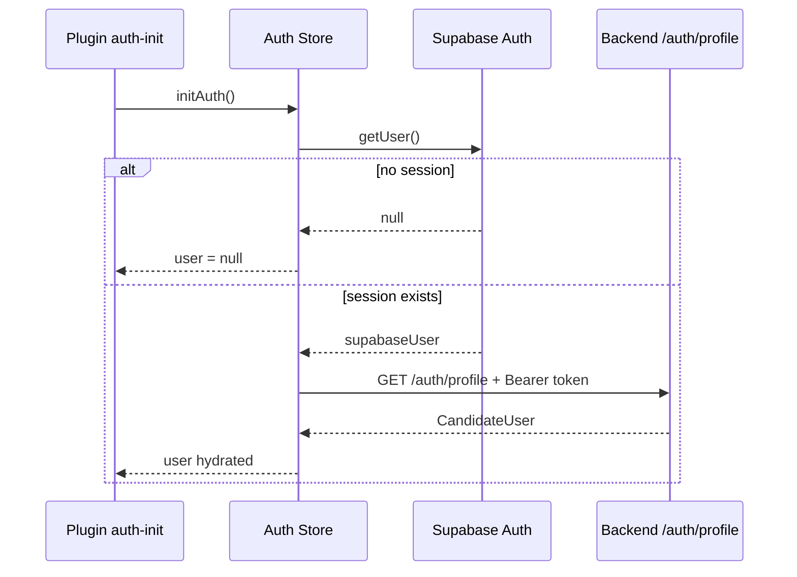

# 07 Auth Authorization

> Last verified against current repository state: 2026-07-13

## Metode Login

Metode login yang ditemukan:

- Email + password
- Provider: Supabase Auth
- Implementasi client: `supabase.auth.signInWithPassword()`

Lokasi code utama:

- `src/features/auth/LoginPage.vue`
- `src/stores/authStore.ts`
- `src/infrastructure/supabase/client.ts`

## Logout

Logout dilakukan dengan:

- `supabase.auth.signOut()`
- reset `authStore.user = null`
- redirect ke `/login`

Lokasi:

- `src/stores/authStore.ts`
- `src/features/dashboard/useDashboardPage.ts`

## Session Handling

### Inisialisasi session

1. Plugin `src/plugins/10.auth-init.client.ts` memanggil `authStore.initAuth()` saat client start.
2. Store membaca `supabase.auth.getUser()`.
3. Jika user Supabase ada, store memanggil backend `/auth/profile`.
4. Profil domain kandidat disimpan ke Pinia.

### Access token untuk backend

Client helper `callBackendApi()` membaca access token dari:

- `supabase.auth.getSession()`

Token lalu dikirim sebagai header:

```http
Authorization: Bearer <access_token>
```

### Session expiry / inactive account

Jika backend mengembalikan `403` dengan pesan mirip `Candidate account is not active.`:

1. client melakukan `supabase.auth.signOut()`
2. store menghapus user lokal
3. user mendapat pesan akun tidak aktif

## Middleware Route Protection

File utama:

- `src/middleware/access.global.ts`

Aturan:

| Kondisi | Hasil |
| --- | --- |
| halaman `public` dan user belum login | akses diizinkan |
| halaman `/login` dan user sudah login | redirect ke `/dashboard` |
| halaman non-public dan user belum login | redirect ke `/login` |
| halaman non-public dan user login | akses diizinkan |

## Role-Based Access Control

Role yang ditemukan:

- `candidate`
- `employee`

Sumber role:

- kolom `candidate_accounts.portal_role`
- payload profile backend `role`

### Perbedaan perilaku antar role

| Area | `candidate` | `employee` |
| --- | --- | --- |
| Dashboard label | workspace kandidat | workspace employee |
| Form yang tampil | seksi form kandidat penuh | seksi payroll employee |
| Dokumen yang ditampilkan | dokumen kandidat | dokumen employee |
| Auto-deactivate 60 hari | Ya | Tidak |

Catatan:

- Tidak ditemukan route khusus employee-only atau candidate-only. Perbedaan akses di level UI/form ditentukan dari role.
- Sejak v1.0.5, akun candidate memiliki auto-deactivate berbasis `activated_at`/`created_at` (bukan lagi 3 hari flat).
- Sejak v1.0.6, konstanta `CANDIDATE_ACTIVE_DAYS` diubah dari `365` menjadi `60`, jadi periode aktif saat ini **60 hari**, bukan 12 bulan. Perubahan ini terbawa dalam commit `f3d2f3d` ("Haermes login guide and dashboard UI polish") tanpa disebutkan di pesan commit — perlu dikonfirmasi ke tim apakah ini perubahan yang disengaja, karena `hrd_ruang` (`src/domain/utils/candidateAccess.ts`) masih memakai `CANDIDATE_ACTIVE_DAYS = 365`, sehingga kedua aplikasi saat ini tidak konsisten soal kapan akun candidate dianggap expired.

## Permission System

Permission granular terpisah tidak ditemukan. Yang ditemukan hanya:

1. auth login Supabase
2. ownership check aplikasi/form di backend
3. role switch `candidate` vs `employee`
4. shared secret untuk internal API

## Access Control Matrix

| Resource | Public | Candidate | Employee | Internal Service |
| --- | --- | --- | --- | --- |
| `/login` | Ya | Redirect jika sudah login | Redirect jika sudah login | Tidak relevan |
| `/dashboard` | Tidak | Ya | Ya | Tidak relevan |
| `/profile` | Tidak | Ya | Ya | Tidak relevan |
| `/applications/:applicationId/form` | Tidak | Ya, jika owner | Ya, jika owner | Tidak relevan |
| `/auth/profile` | Tidak | Ya, perlu Bearer token | Ya, perlu Bearer token | Tidak |
| `/auth/applications/:id/form` | Tidak | Ya, perlu Bearer token + ownership | Ya, perlu Bearer token + ownership | Tidak |
| `/api/internal/candidates*` | Tidak | Tidak | Tidak | Ya, perlu `x-internal-service-token` |
| Supabase Storage object | Tidak | Ya, bila object milik sendiri | Ya, bila object milik sendiri | Service role via backend bila diperlukan |

## Halaman Yang Membutuhkan Login

- `/dashboard`
- `/profile`
- `/applications/[applicationId]/form`

## Halaman Yang Dibatasi Berdasarkan Role

Pembatasan yang ditemukan bersifat perilaku, bukan route:

| Halaman | Pembatasan |
| --- | --- |
| `/dashboard` | label dan CTA berubah mengikuti role |
| `/applications/[applicationId]/form` | kandidat melihat form kandidat; employee melihat payroll + dokumen employee |
| `/profile` | teks judul/eyebrow berubah mengikuti role |

Tidak ditemukan halaman terpisah seperti `/employee/*` atau `/admin/*`.

## Contoh Alur Auth Dari Kode



## Authorization Di Backend

### Auth route

`server/utils/requestContext.ts`:

1. baca header `authorization`
2. pastikan prefix `Bearer `
3. verifikasi token dengan `supabase.auth.getUser(accessToken)`
4. kembalikan `userId = auth.uid()`

### Internal route

`server/services/internalAuthService.js`:

1. baca header `x-internal-service-token`
2. bandingkan dengan `INTERNAL_SERVICE_TOKEN`
3. jika tidak cocok -> `401 Unauthorized internal request.`
