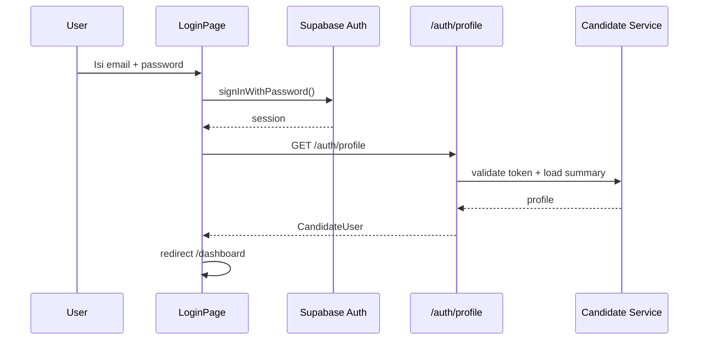
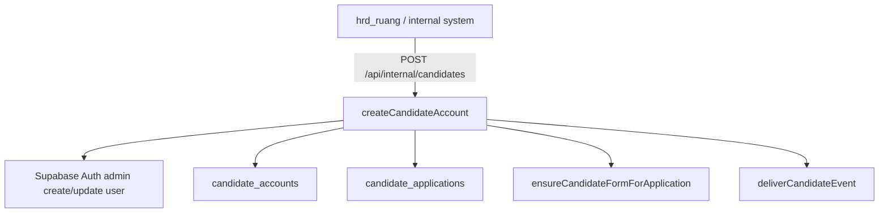
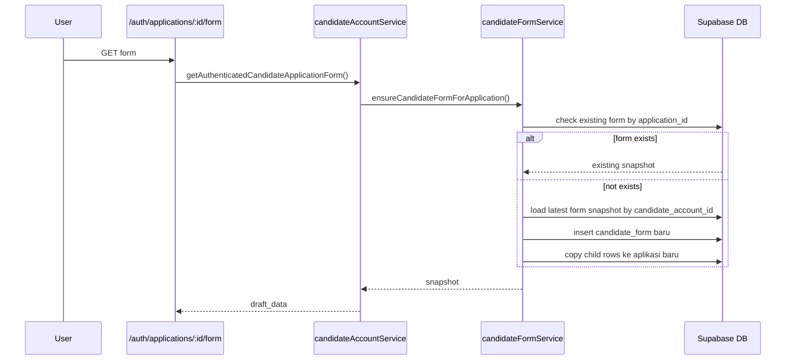
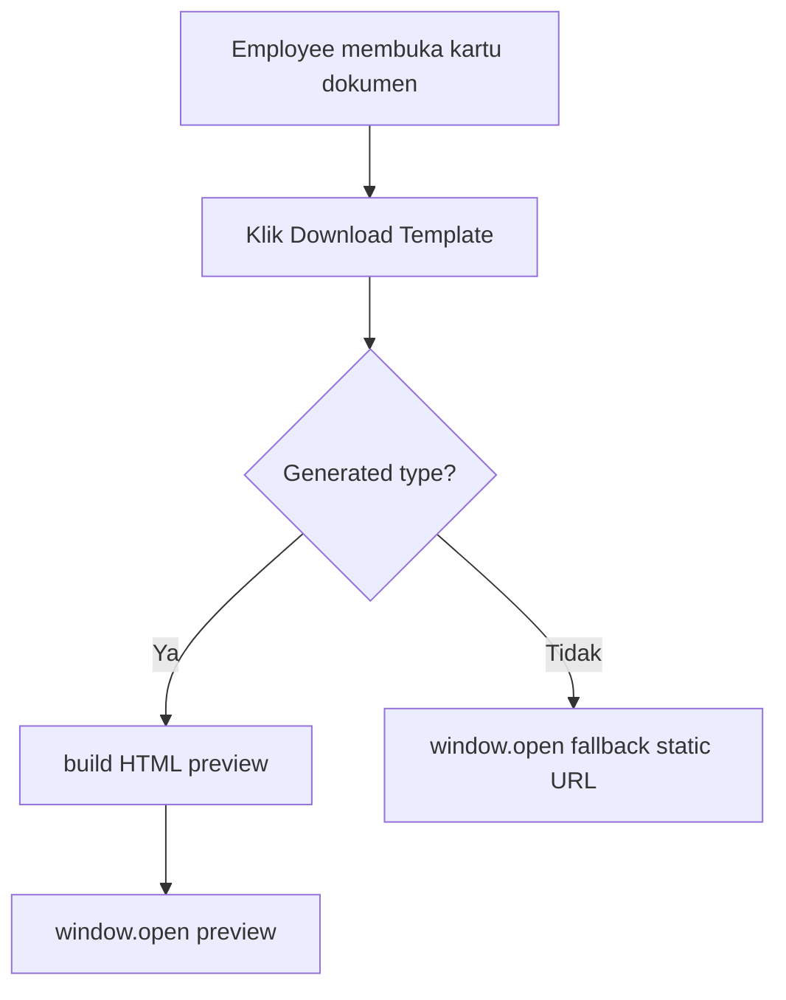
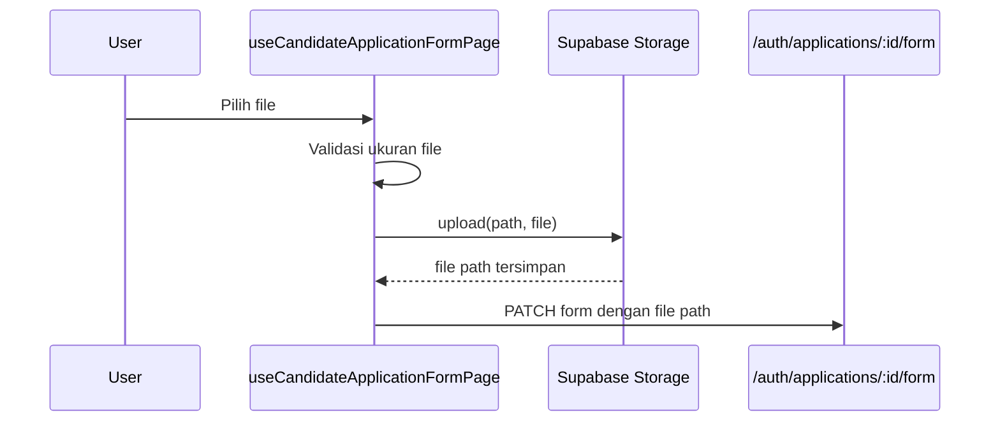

# 10 Feature Flow

> Last verified against current repository state: 2026-07-13

## Catatan Scope

Beberapa flow yang diminta tidak ditemukan sebagai implementasi aktif di repo ini:

- Import CSV
- Upload DOCX template
- Deteksi placeholder DOCX
- Export Configuration
- Field mapping export
- Audit log khusus

Bagian tersebut tetap dicantumkan dengan status yang jelas.

## 1. Flow Login

Catatan tambahan (dashboard):

- Bagian "Dokumen" pada dashboard menampilkan guide card Haermes (`ApplicationDocumentsSection.vue`) dengan catatan login: User ID = `employee_code` milik user (fallback teks bila kosong), dan default password `1234` (hardcoded di UI, bukan dari backend).
- Kartu dokumen `integrity_pact` menampilkan catatan tambahan (`files.integrityPactPrintNote`) bahwa dokumen wajib dicetak (hard copy) dan ditempel materai setelah diisi.

## 2. Flow Manajemen User / Kandidat

Status: Ditemukan sebagai internal API, bukan UI web di repo ini.

Catatan: `deliverCandidateEvent` retry sekali (total maksimal 2 attempt, delay 500ms) bila kegagalan bersifat transient (timeout/network error/HTTP 5xx/429). Detail lihat docs/16-error-handling.md.

Operasi yang ditemukan:

- create kandidat
- update kandidat
- revoke kandidat
- reset password
- aktif/nonaktif kandidat
- ambil summary kandidat

## 3. Flow Manajemen Candidate/Employee

### Candidate

1. Kandidat login.
2. Dashboard menampilkan daftar aplikasi.
3. Kandidat membuka form.
4. Kandidat mengisi wizard form per langkah, unggah foto, lalu unggah dokumen.
5. Kandidat save draft atau submit.

Validasi sebelum submit (frontend, `canSubmitForm` di `useCandidateApplicationFormPage.ts`):

- data pribadi, kontak/identitas, kontak darurat wajib, pendidikan formal wajib, dan entri riwayat kerja pertama harus lengkap
- minimal 2 referensi lengkap (nama, nomor telepon, hubungan, posisi) lewat `hasMinimumReferences`
- data mobilitas/domisili dan gaji yang diharapkan harus terisi
- dokumen kandidat wajib sudah diunggah

Field wajib pada section form ditandai lewat helper `requiredLabel()` (lihat docs/12-component-documentation.md). Backend (`validateFormSubmission` di `candidateAccountService.js`) sendiri masih stub dan tidak menolak payload tidak lengkap — lihat docs/16-error-handling.md.

### Employee

1. `portal_role` kandidat diubah menjadi `employee`.
2. User login dengan akun yang sama.
3. Form berubah menjadi wizard 2 langkah: payroll lalu dokumen employee.
4. Employee dapat membuka preview dokumen tertentu.

Catatan:

- Endpoint switch role aktif di `server/routes/internal/.../switch-to-employee.post.ts`.
- Alias `/api/internal/.../switch-to-employee` belum ditemukan di `server/api/`.

## 4. Flow Import CSV

Status: Belum ditemukan di implementasi saat ini.

Temuan:

- tidak ada page/import UI
- tidak ada parser CSV
- tidak ada endpoint import
- tidak ada dependency CSV parser di `package.json`

## 5. Flow Upload DOCX Template

Status: Belum ditemukan di implementasi saat ini.

Temuan:

- tidak ada UI upload template
- tidak ada endpoint upload template
- tidak ada service DOCX processing
- aset statis `SKB.docx` yang dulu ada di `src/public/templates/` sudah dihapus (commit `e8d4e4c`); folder tersebut sudah tidak ada di repo

## 6. Flow Deteksi Placeholder DOCX

Status: Belum ditemukan di implementasi saat ini.

## 7. Flow Export Configuration

Status: Belum ditemukan di implementasi saat ini.

## 8. Flow Mapping Field

Status: Belum ditemukan sebagai modul field mapping export.

Yang ditemukan:

- mapping internal antara snapshot database dan draft form di `candidateFormService`
- auto normalization dari field lama seperti `first_name/middle_name/last_name` ke `full_name`

## 9. Flow Auto-fill Data Candidate

Auto-fill yang ditemukan:

- `full_name` dari `candidate_accounts.full_name`
- `personal_email` dari `candidate_accounts.email`
- `phone_number` dari `candidate_accounts.phone`
- data child table terakhir saat ada form lamaran sebelumnya

## 10. Flow Manual Override Field

Status: Ditemukan.

Cara kerja:

1. UI memuat `draft_data`.
2. User bebas mengubah field pada state lokal reactive.
3. Saat save, payload dikirim penuh ke backend.
4. Backend menormalkan field lalu mengganti child rows dengan state terbaru.
5. Khusus `employee_documents`, sejak fix `78e3739` penggantian dibatasi ke tipe dokumen yang boleh diedit candidate/employee sendiri (di luar `format_office`/`skb`/`other`), supaya save draft yang stale tidak menimpa dokumen kontrak yang sudah diupload HR.

## 11. Flow Generate Document

Status: Ditemukan terbatas.

Jenis yang ditemukan:

- `integrity_pact`
- `email_usage_policy`

Catatan:

- Flow ini membuka preview HTML, bukan menghasilkan file DOCX.
- Tombol `Download Template` hanya aktif untuk `integrity_pact` dan `email_usage_policy`.
- `SKB.docx` sudah dihapus dari repo (commit `e8d4e4c`) dan tidak lagi tersedia sebagai fallback asset statis.

## 12. Flow Download Document

### Yang ditemukan

- download/preview generated employee doc via `window.open`
- preview foto kandidat via signed URL
- internal signed URL endpoint untuk storage object tertentu

### Yang belum ditemukan

- tombol download uploaded file di UI kandidat
- generate dan download file final `.docx`

## 13. Flow Upload File Ke Supabase Storage

Detail implementasi:

- Foto:
  - max `5 MB`
  - bucket `candidate-photographs`
  - path `candidate-forms/<auth.uid()>/<filename>`
- Dokumen:
  - max `10 MB`
  - bucket `candidate-documents`
  - path `employee-forms/<auth.uid()>/<documentType>/<filename>`

## 14. Flow Audit Log

Status: Belum ditemukan di implementasi saat ini.

Yang ditemukan sebagai pengganti parsial:

- kolom `created_by`, `updated_by`, `created_by_internal_user_id` di `candidate_accounts`
- event push ke `hrd_ruang`:
  - `candidate.account_created`
  - `candidate.account_status_changed`
  - `candidate.application_status_changed`
  - `candidate.portal_role_changed`
  - `candidate.password_reset`
  - `candidate.form_progress_updated`
  - `candidate.application_submitted`
  - `candidate.employee_draft_contract_submitted`
